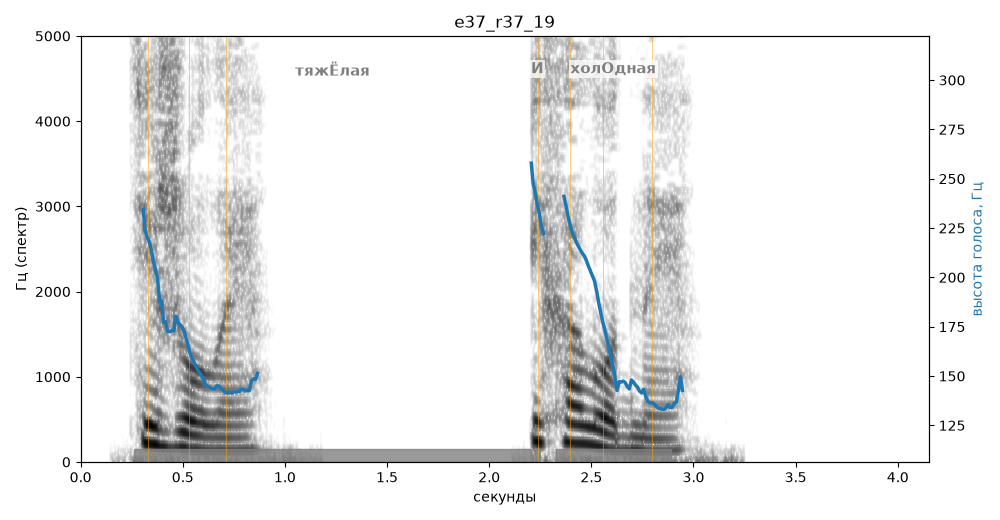

# e37_r37_19

Голос: **edge:ru-RU-SvetlanaNeural** · длительность 4.2 с
Естественность (UTMOS): **3.92 из 5** (живой диктор ≈ 4–4.5)
Эталон: Тяжёлая. И холодная!
Распознано: тяжелые и холодные
Расхождения в словах: «тяжелая» → «тяжелые»; «холодная» → «холодные»

## Ударения
(где нужно: ruaccent)

| слово | нужно | у голоса | |
|---|---|---|---|
| тяжёлая | тяжЁлая | — | ? |
| холодная | холОдная | — | ? |

## Интонация
- ✗ «тяжёлая.» — конец фразы не понижается — звучит незаконченно / как перечисление
- ✓ «и холодная!» — выделено слово «и» (+3.7 пт)
- Диапазон голоса 9.7 полутонов (живо), средняя высота 151 Гц

## Паузы и темп
- после «тяжёлая.» пауза всего 0.02 с — фразы слипаются
- Темп 2.7 слога/с (медленно)

_Синяя линия — высота голоса. Над словами заглавная буква — где ударение должно быть; красным — голос поставил не туда (уверенно), оранжевым — возможно._
