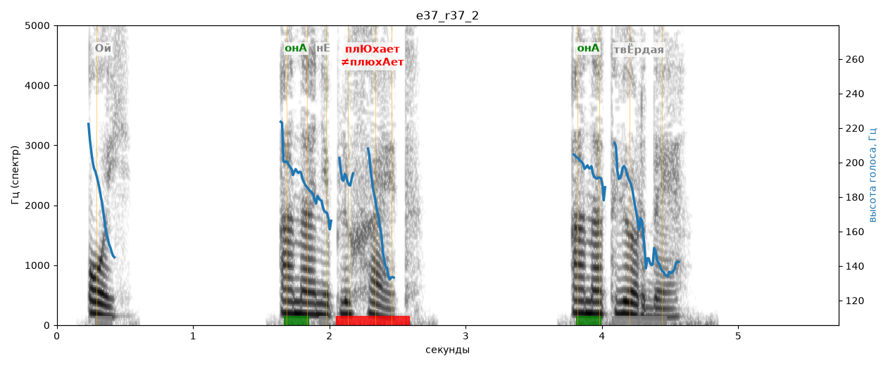

# e37_r37_2

Голос: **edge:ru-RU-SvetlanaNeural** · длительность 5.7 с
Естественность (UTMOS): **3.76 из 5** (живой диктор ≈ 4–4.5)
Эталон: Ой! Она не плюхает! Она твёрдая!
Распознано: Ой! Она не плюхает. Она твердая.
Слова: все совпали

## Ударения
(где нужно: ruaccent)

| слово | нужно | у голоса | |
|---|---|---|---|
| она | онА | онА | ✓ |
| плюхает | плЮхает | плюхАет | ✗ ОШИБКА |
| она | онА | онА | ✓ |
| твёрдая | твЁрдая | — | ? |

## Интонация
- ✗ «она не плюхает!» — восклицание звучит ровно, без эмоции
- ✗ «она твёрдая!» — восклицание звучит ровно, без эмоции
- Диапазон голоса 7.1 полутонов (живо), средняя высота 185 Гц

## Паузы и темп
- паузы на своих местах
- Темп 6.5 слога/с (нормально)

_Синяя линия — высота голоса. Над словами заглавная буква — где ударение должно быть; красным — голос поставил не туда (уверенно), оранжевым — возможно._
