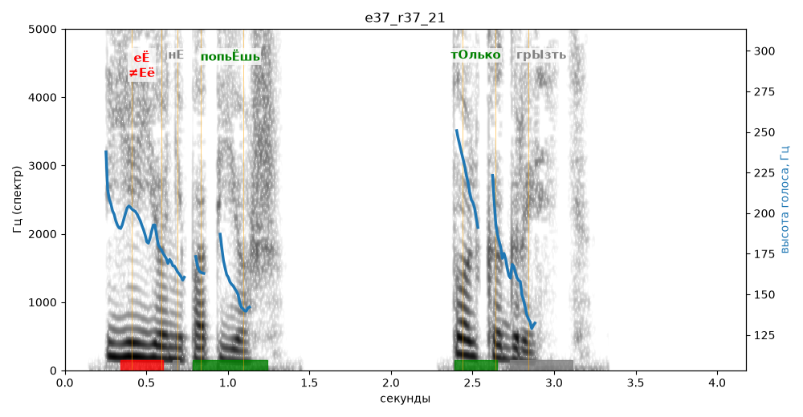

# e37_r37_21

Голос: **edge:ru-RU-SvetlanaNeural** · длительность 4.2 с
Естественность (UTMOS): **3.82 из 5** (живой диктор ≈ 4–4.5)
Эталон: Её не попьёшь! Только грызть!
Распознано: Её не попьёшь. Только грызть.
Слова: все совпали

## Ударения
(где нужно: ruaccent)

| слово | нужно | у голоса | |
|---|---|---|---|
| её | еЁ | Её | ✗ ОШИБКА |
| попьёшь | попьЁшь | попьЁшь | ✓ |
| только | тОлько | тОлько | ✓ |

## Интонация
- ✗ «её не попьёшь!» — восклицание звучит ровно, без эмоции
- ✓ «только грызть!» — выделено слово «только» (+3.8 пт)
- Диапазон голоса 8.7 полутонов (живо), средняя высота 175 Гц

## Паузы и темп
- паузы на своих местах
- Темп 4.9 слога/с (нормально)

_Синяя линия — высота голоса. Над словами заглавная буква — где ударение должно быть; красным — голос поставил не туда (уверенно), оранжевым — возможно._
