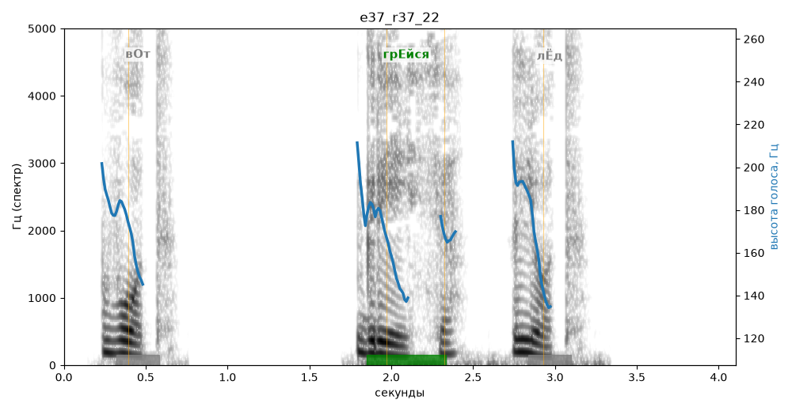

# e37_r37_22

Голос: **edge:ru-RU-SvetlanaNeural** · длительность 4.1 с
Естественность (UTMOS): **3.66 из 5** (живой диктор ≈ 4–4.5)
Эталон: Вот. Грейся, лёд.
Распознано: Вот. Грейся, лед.
Слова: все совпали

## Ударения
(где нужно: ruaccent)

| слово | нужно | у голоса | |
|---|---|---|---|
| грейся | грЕйся | грЕйся | ✓ |

## Интонация
- ✓ «грейся лёд.» — конец фразы понижается — звучит законченно
- Диапазон голоса 6.1 полутонов (нормально), средняя высота 174 Гц

## Паузы и темп
- паузы на своих местах
- Темп 4.0 слога/с (нормально)

_Синяя линия — высота голоса. Над словами заглавная буква — где ударение должно быть; красным — голос поставил не туда (уверенно), оранжевым — возможно._
