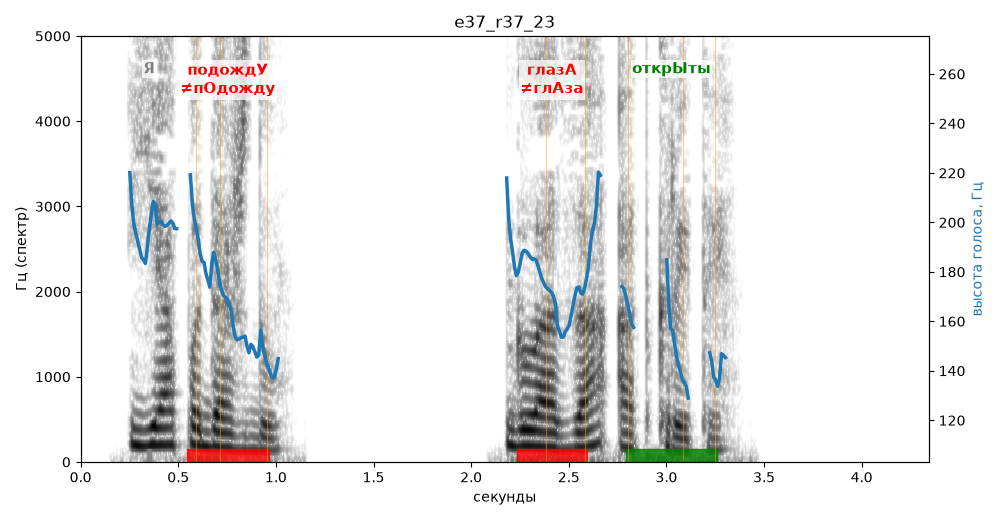

# e37_r37_23

Голос: **edge:ru-RU-SvetlanaNeural** · длительность 4.3 с
Естественность (UTMOS): **3.89 из 5** (живой диктор ≈ 4–4.5)
Эталон: Я подожду. Глаза открыты.
Распознано: Я подожду. Глаза открыты.
Слова: все совпали

## Ударения
(где нужно: ruaccent)

| слово | нужно | у голоса | |
|---|---|---|---|
| подожду | подождУ | пОдожду | ✗ ОШИБКА |
| глаза | глазА | глАза | ✗ ОШИБКА |
| открыты | открЫты | открЫты | ✓ |

## Интонация
- ✓ «я подожду.» — конец фразы понижается — звучит законченно
- ✓ «глаза открыты.» — конец фразы понижается — звучит законченно
- Диапазон голоса 7.1 полутонов (живо), средняя высота 174 Гц

## Паузы и темп
- паузы на своих местах
- Темп 6.3 слога/с (нормально)

_Синяя линия — высота голоса. Над словами заглавная буква — где ударение должно быть; красным — голос поставил не туда (уверенно), оранжевым — возможно._
