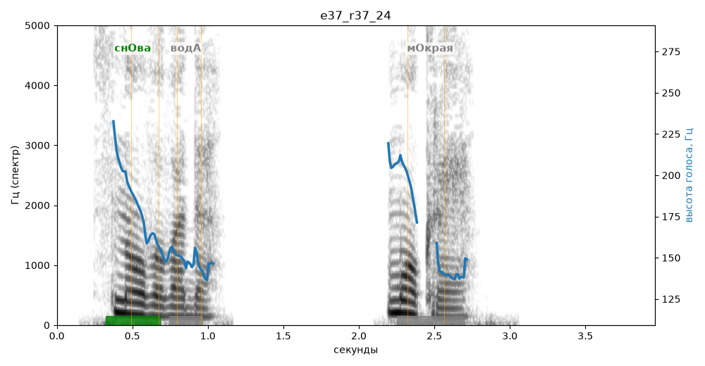

# e37_r37_24

Голос: **edge:ru-RU-SvetlanaNeural** · длительность 4.0 с
Естественность (UTMOS): **3.76 из 5** (живой диктор ≈ 4–4.5)
Эталон: Снова вода! Мокрая!
Распознано: Снова вода. Мокрая.
Слова: все совпали

## Ударения
(где нужно: ruaccent)

| слово | нужно | у голоса | |
|---|---|---|---|
| снова | снОва | снОва | ✓ |
| вода | водА | вОда | ? не разобрать |
| мокрая | мОкрая | — | ? |

## Интонация
- ✓ «снова вода!» — выделено слово «снова» (+3.5 пт)
- Диапазон голоса 7.3 полутонов (живо), средняя высота 156 Гц

## Паузы и темп
- паузы на своих местах
- Темп 5.5 слога/с (нормально)

_Синяя линия — высота голоса. Над словами заглавная буква — где ударение должно быть; красным — голос поставил не туда (уверенно), оранжевым — возможно._
