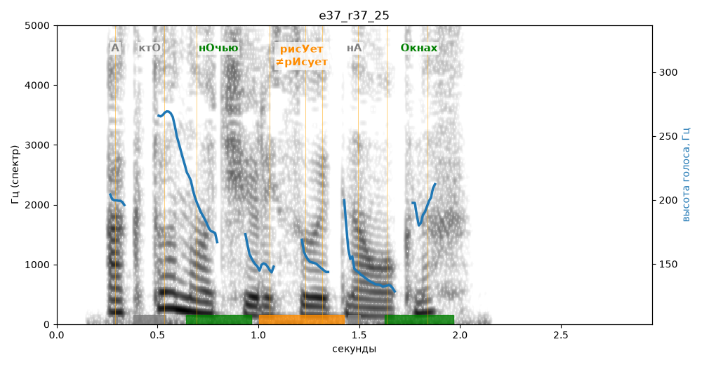

# e37_r37_25

Голос: **edge:ru-RU-SvetlanaNeural** · длительность 3.0 с
Естественность (UTMOS): **3.8 из 5** (живой диктор ≈ 4–4.5)
Эталон: А кто ночью рисует на окнах?
Распознано: А кто ночью рисует на окнах?
Слова: все совпали

## Ударения
(где нужно: ruaccent)

| слово | нужно | у голоса | |
|---|---|---|---|
| ночью | нОчью | нОчью | ✓ |
| рисует | рисУет | рИсует | ✗? возможно — послушать |
| окнах | Окнах | Окнах | ✓ |

## Интонация
- ✓ «а кто ночью рисует на окнах?» — вопросительный подъём на слове «кто»
- Диапазон голоса 12.0 полутонов (живо), средняя высота 169 Гц

## Паузы и темп
- паузы на своих местах
- Темп 5.3 слога/с (нормально)

_Синяя линия — высота голоса. Над словами заглавная буква — где ударение должно быть; красным — голос поставил не туда (уверенно), оранжевым — возможно._
