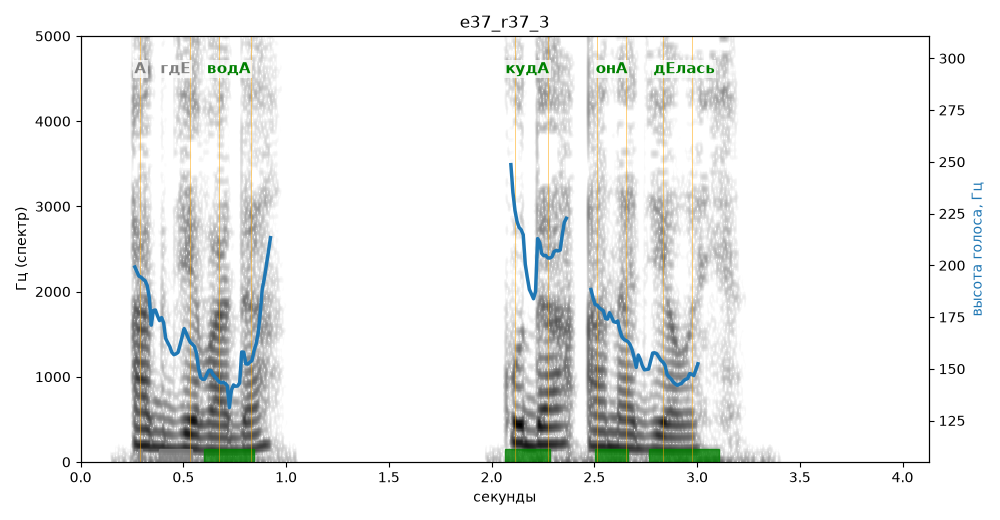

# e37_r37_3

Голос: **edge:ru-RU-SvetlanaNeural** · длительность 4.1 с
Естественность (UTMOS): **4.08 из 5** (живой диктор ≈ 4–4.5)
Эталон: А где вода? Куда она делась?
Распознано: А где вода? Куда она делась?
Слова: все совпали

## Ударения
(где нужно: ruaccent)

| слово | нужно | у голоса | |
|---|---|---|---|
| вода | водА | водА | ✓ |
| куда | кудА | кудА | ✓ |
| она | онА | онА | ✓ |
| делась | дЕлась | дЕлась | ✓ |

## Интонация
- ✗ «а где вода?» — нет вопросительного подъёма (самое высокое место — «а», в начале) — звучит как утверждение
- ✓ «куда она делась?» — конец фразы понижается — звучит законченно
- Диапазон голоса 7.2 полутонов (живо), средняя высота 163 Гц

## Паузы и темп
- паузы на своих местах
- Темп 7.2 слога/с (быстро)

_Синяя линия — высота голоса. Над словами заглавная буква — где ударение должно быть; красным — голос поставил не туда (уверенно), оранжевым — возможно._
