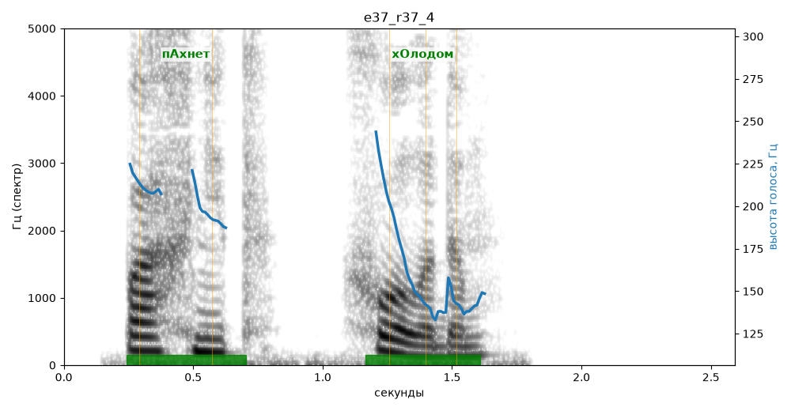

# e37_r37_4

Голос: **edge:ru-RU-SvetlanaNeural** · длительность 2.6 с
Естественность (UTMOS): **3.91 из 5** (живой диктор ≈ 4–4.5)
Эталон: Пахнет… холодом.
Распознано: Пахнет, холодом.
Слова: все совпали

## Ударения
(где нужно: ruaccent)

| слово | нужно | у голоса | |
|---|---|---|---|
| пахнет | пАхнет | пАхнет | ✓ |
| холодом | хОлодом | хОлодом | ✓ |

## Интонация
- ✗ «холодом.» — конец фразы не понижается — звучит незаконченно / как перечисление
- Диапазон голоса 8.4 полутонов (живо), средняя высота 187 Гц

## Паузы и темп
- паузы на своих местах
- Темп 5.5 слога/с (нормально)

_Синяя линия — высота голоса. Над словами заглавная буква — где ударение должно быть; красным — голос поставил не туда (уверенно), оранжевым — возможно._
