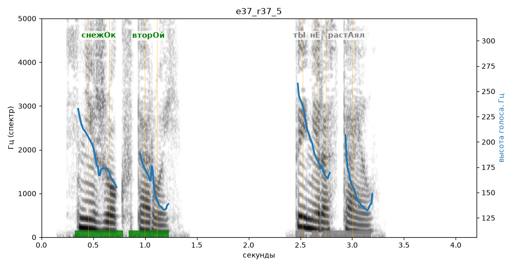

# e37_r37_5

Голос: **edge:ru-RU-SvetlanaNeural** · длительность 4.2 с
Естественность (UTMOS): **3.89 из 5** (живой диктор ≈ 4–4.5)
Эталон: Снежок Второй! Ты не растаял!
Распознано: Снижок второй. Ты не расстаял.
Расхождения в словах: «снежок» → «снижок»; «растаял» → «расстаял»

## Ударения
(где нужно: ruaccent)

| слово | нужно | у голоса | |
|---|---|---|---|
| снежок | снежОк | снежОк | ✓ |
| второй | вторОй | вторОй | ✓ |
| растаял | растАял | — | ? |

## Интонация
- ✗ «снежок второй!» — восклицание звучит ровно, без эмоции
- ✓ «ты не растаял!» — выделено слово «ты» (+4.7 пт)
- Диапазон голоса 9.5 полутонов (живо), средняя высота 172 Гц

## Паузы и темп
- паузы на своих местах
- Темп 4.9 слога/с (нормально)

_Синяя линия — высота голоса. Над словами заглавная буква — где ударение должно быть; красным — голос поставил не туда (уверенно), оранжевым — возможно._
