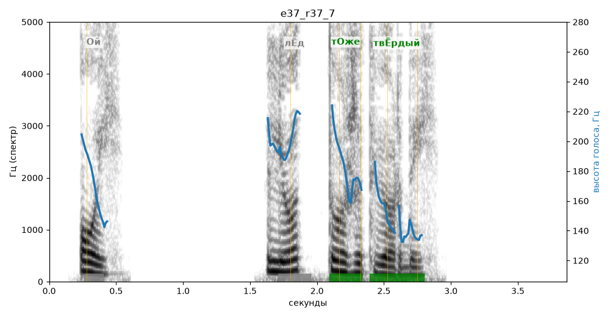

# e37_r37_7

Голос: **edge:ru-RU-SvetlanaNeural** · длительность 3.9 с
Естественность (UTMOS): **3.45 из 5** (живой диктор ≈ 4–4.5)
Эталон: Ой. Лёд тоже твёрдый.
Распознано: Ой! Лед тоже твердый.
Слова: все совпали

## Ударения
(где нужно: ruaccent)

| слово | нужно | у голоса | |
|---|---|---|---|
| тоже | тОже | тОже | ✓ |
| твёрдый | твЁрдый | твЁрдый | ✓ |

## Интонация
- ✓ «лёд тоже твёрдый.» — конец фразы понижается — звучит законченно
- Диапазон голоса 8.0 полутонов (живо), средняя высота 174 Гц

## Паузы и темп
- паузы на своих местах
- Темп 4.9 слога/с (нормально)

_Синяя линия — высота голоса. Над словами заглавная буква — где ударение должно быть; красным — голос поставил не туда (уверенно), оранжевым — возможно._
