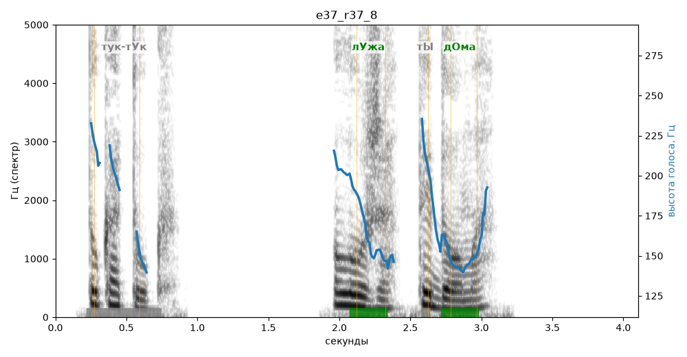

# e37_r37_8

Голос: **edge:ru-RU-SvetlanaNeural** · длительность 4.1 с
Естественность (UTMOS): **3.7 из 5** (живой диктор ≈ 4–4.5)
Эталон: Тук-тук! Лужа, ты дома?
Распознано: Тукатук. Лужа, ты дома?
Расхождения в словах: «тук-тук» → «тукатук»

## Ударения
(где нужно: ruaccent)

| слово | нужно | у голоса | |
|---|---|---|---|
| тук-тук | тук-тУк | тУк-тук | ? не разобрать |
| лужа | лУжа | лУжа | ✓ |
| дома | дОма | дОма | ✓ |

## Интонация
- ✓ «лужа ты дома?» — вопросительный подъём на слове «ты»
- Диапазон голоса 7.5 полутонов (живо), средняя высота 162 Гц

## Паузы и темп
- паузы на своих местах
- Темп 5.9 слога/с (нормально)

_Синяя линия — высота голоса. Над словами заглавная буква — где ударение должно быть; красным — голос поставил не туда (уверенно), оранжевым — возможно._
