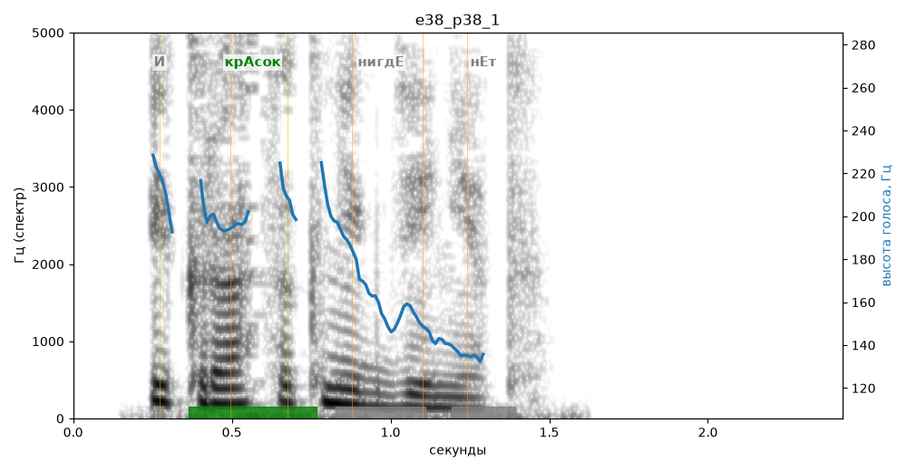

# e38_p38_1

Голос: **edge:ru-RU-SvetlanaNeural** · длительность 2.4 с
Естественность (UTMOS): **4.1 из 5** (живой диктор ≈ 4–4.5)
Эталон: И красок нигде нет.
Распознано: И красок нигде нет.
Слова: все совпали

## Ударения
(где нужно: ruaccent)

| слово | нужно | у голоса | |
|---|---|---|---|
| красок | крАсок | крАсок | ✓ |
| нигде | нигдЕ | нИгде | ? не разобрать |

## Интонация
- ✓ «и красок нигде нет.» — конец фразы понижается — звучит законченно
- Диапазон голоса 8.4 полутонов (живо), средняя высота 180 Гц

## Паузы и темп
- паузы на своих местах
- Темп 5.3 слога/с (нормально)

_Синяя линия — высота голоса. Над словами заглавная буква — где ударение должно быть; красным — голос поставил не туда (уверенно), оранжевым — возможно._
