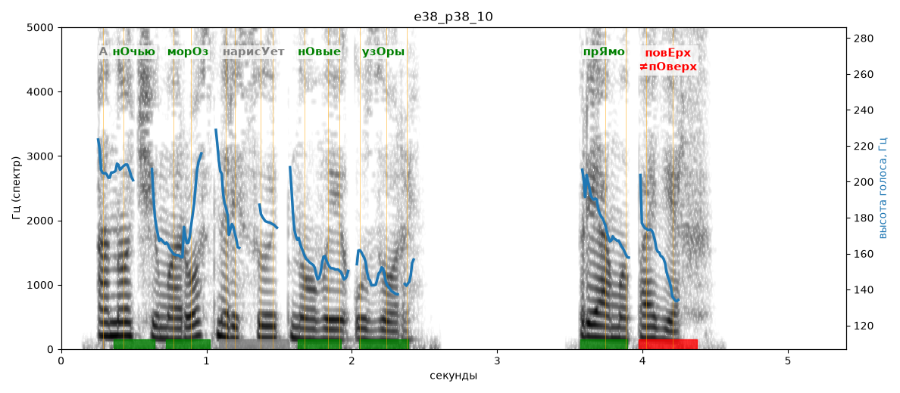

# e38_p38_10

Голос: **edge:ru-RU-SvetlanaNeural** · длительность 5.4 с
Естественность (UTMOS): **3.69 из 5** (живой диктор ≈ 4–4.5)
Эталон: А ночью мороз нарисует новые узоры. Прямо поверх.
Распознано: А ночью мороз нарисует новые узоры. Прямо поверх.
Слова: все совпали

## Ударения
(где нужно: ruaccent)

| слово | нужно | у голоса | |
|---|---|---|---|
| ночью | нОчью | нОчью | ✓ |
| мороз | морОз | морОз | ✓ |
| нарисует | нарисУет | нарИсует | ? не разобрать |
| новые | нОвые | нОвые | ✓ |
| узоры | узОры | узОры | ✓ |
| прямо | прЯмо | прЯмо | ✓ |
| поверх | повЕрх | пОверх | ✗ ОШИБКА |

## Интонация
- ✓ «а ночью мороз нарисует новые узоры.» — конец фразы понижается — звучит законченно
- ✓ «прямо поверх.» — конец фразы понижается — звучит законченно
- Диапазон голоса 6.8 полутонов (нормально), средняя высота 167 Гц

## Паузы и темп
- паузы на своих местах
- Темп 6.2 слога/с (нормально)

_Синяя линия — высота голоса. Над словами заглавная буква — где ударение должно быть; красным — голос поставил не туда (уверенно), оранжевым — возможно._
