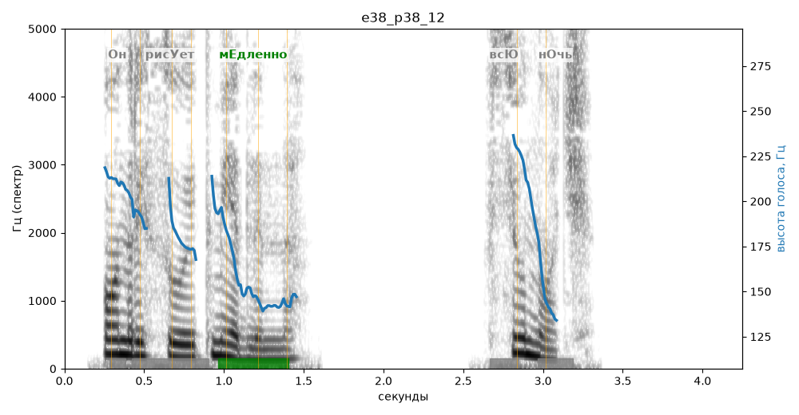

# e38_p38_12

Голос: **edge:ru-RU-SvetlanaNeural** · длительность 4.2 с
Естественность (UTMOS): **3.95 из 5** (живой диктор ≈ 4–4.5)
Эталон: Он рисует медленно. Всю ночь.
Распознано: Он рисует медленно. Всю ночь.
Слова: все совпали

## Ударения
(где нужно: ruaccent)

| слово | нужно | у голоса | |
|---|---|---|---|
| рисует | рисУет | рИсует | ? не разобрать |
| медленно | мЕдленно | мЕдленно | ✓ |

## Интонация
- ✗ «он рисует медленно.» — конец фразы не понижается — звучит незаконченно / как перечисление
- Диапазон голоса 7.8 полутонов (живо), средняя высота 177 Гц

## Паузы и темп
- паузы на своих местах
- Темп 5.5 слога/с (нормально)

_Синяя линия — высота голоса. Над словами заглавная буква — где ударение должно быть; красным — голос поставил не туда (уверенно), оранжевым — возможно._
