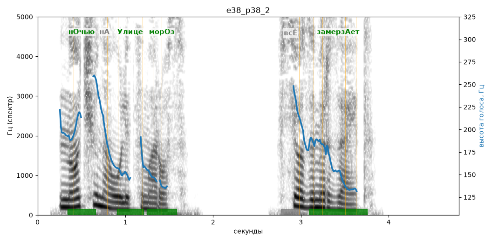

# e38_p38_2

Голос: **edge:ru-RU-SvetlanaNeural** · длительность 4.8 с
Естественность (UTMOS): **3.79 из 5** (живой диктор ≈ 4–4.5)
Эталон: Ночью на улице мороз. Всё замерзает.
Распознано: Ночью на улице мороз. Всё замерзает.
Слова: все совпали

## Ударения
(где нужно: ruaccent)

| слово | нужно | у голоса | |
|---|---|---|---|
| ночью | нОчью | нОчью | ✓ |
| улице | Улице | Улице | ✓ |
| мороз | морОз | морОз | ✓ |
| замерзает | замерзАет | замерзАет | ✓ |

## Интонация
- ✓ «ночью на улице мороз.» — конец фразы понижается — звучит законченно
- ✓ «всё замерзает.» — конец фразы понижается — звучит законченно
- Диапазон голоса 9.8 полутонов (живо), средняя высота 175 Гц

## Паузы и темп
- паузы на своих местах
- Темп 5.4 слога/с (нормально)

_Синяя линия — высота голоса. Над словами заглавная буква — где ударение должно быть; красным — голос поставил не туда (уверенно), оранжевым — возможно._
