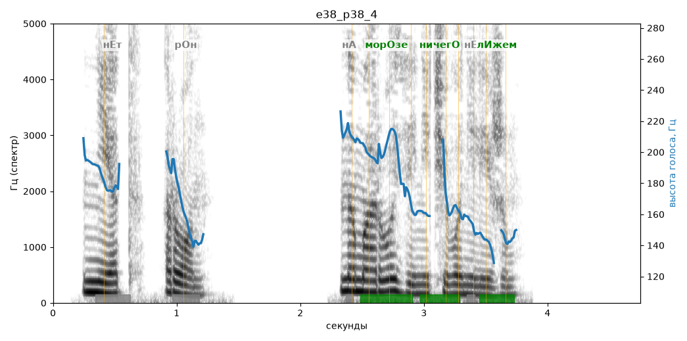

# e38_p38_4

Голос: **edge:ru-RU-SvetlanaNeural** · длительность 4.8 с
Естественность (UTMOS): **4.03 из 5** (живой диктор ≈ 4–4.5)
Эталон: Нет, Рон! На морозе ничего не лижем!
Распознано: Нет, Рон. На морозе ничего не лежим.
Расхождения в словах: «лижем» → «лежим»

## Ударения
(где нужно: ruaccent)

| слово | нужно | у голоса | |
|---|---|---|---|
| морозе | морОзе | морОзе | ✓ |
| ничего | ничегО | ничегО | ✓ |
| лижем | лИжем | лИжем | ✓ |

## Интонация
- ✓ «на морозе ничего не лижем!» — выделено слово «на» (+4.4 пт)
- Диапазон голоса 7.1 полутонов (живо), средняя высота 175 Гц

## Паузы и темп
- паузы на своих местах
- Темп 6.4 слога/с (нормально)

_Синяя линия — высота голоса. Над словами заглавная буква — где ударение должно быть; красным — голос поставил не туда (уверенно), оранжевым — возможно._
