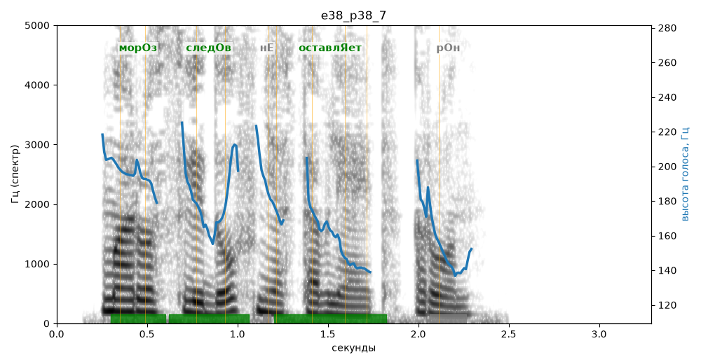

# e38_p38_7

Голос: **edge:ru-RU-SvetlanaNeural** · длительность 3.3 с
Естественность (UTMOS): **3.94 из 5** (живой диктор ≈ 4–4.5)
Эталон: Мороз следов не оставляет, Рон.
Распознано: Мороз следов не оставляет, Рон.
Слова: все совпали

## Ударения
(где нужно: ruaccent)

| слово | нужно | у голоса | |
|---|---|---|---|
| мороз | морОз | морОз | ✓ |
| следов | следОв | следОв | ✓ |
| оставляет | оставлЯет | оставлЯет | ✓ |

## Интонация
- ✓ «мороз следов не оставляет рон.» — конец фразы понижается — звучит законченно
- Диапазон голоса 7.0 полутонов (живо), средняя высота 173 Гц

## Паузы и темп
- паузы на своих местах
- Темп 5.8 слога/с (нормально)

_Синяя линия — высота голоса. Над словами заглавная буква — где ударение должно быть; красным — голос поставил не туда (уверенно), оранжевым — возможно._
