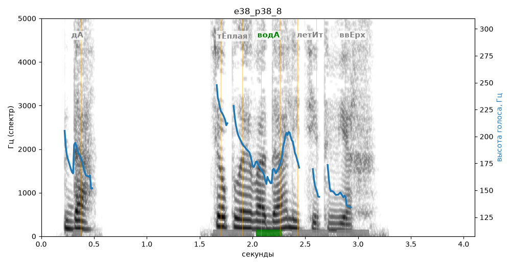

# e38_p38_8

Голос: **edge:ru-RU-SvetlanaNeural** · длительность 4.1 с
Естественность (UTMOS): **3.75 из 5** (живой диктор ≈ 4–4.5)
Эталон: Да. Тёплая вода летит вверх.
Распознано: Да. Теплая вода летит вверх.
Слова: все совпали

## Ударения
(где нужно: ruaccent)

| слово | нужно | у голоса | |
|---|---|---|---|
| тёплая | тЁплая | — | ? |
| вода | водА | водА | ✓ |
| летит | летИт | лЕтит | ? не разобрать |

## Интонация
- ✓ «тёплая вода летит вверх.» — конец фразы понижается — звучит законченно
- Диапазон голоса 7.4 полутонов (живо), средняя высота 173 Гц

## Паузы и темп
- паузы на своих местах
- Темп 5.2 слога/с (нормально)

_Синяя линия — высота голоса. Над словами заглавная буква — где ударение должно быть; красным — голос поставил не туда (уверенно), оранжевым — возможно._
