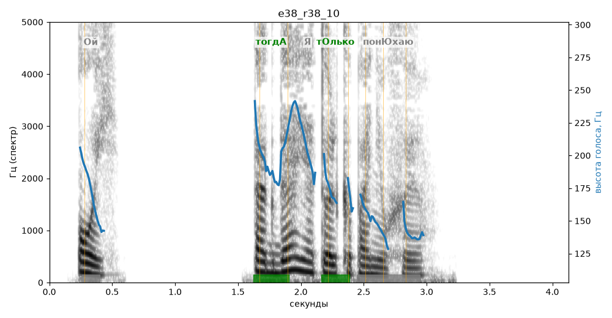

# e38_r38_10

Голос: **edge:ru-RU-SvetlanaNeural** · длительность 4.1 с
Естественность (UTMOS): **3.93 из 5** (живой диктор ≈ 4–4.5)
Эталон: Ой. Тогда я только понюхаю.
Распознано: Ой. Тогда я только понюхаю.
Слова: все совпали

## Ударения
(где нужно: ruaccent)

| слово | нужно | у голоса | |
|---|---|---|---|
| тогда | тогдА | тогдА | ✓ |
| только | тОлько | тОлько | ✓ |
| понюхаю | понЮхаю | — | ? |

## Интонация
- ✓ «тогда я только понюхаю.» — конец фразы понижается — звучит законченно
- Диапазон голоса 9.3 полутонов (живо), средняя высота 177 Гц

## Паузы и темп
- паузы на своих местах
- Темп 5.5 слога/с (нормально)

_Синяя линия — высота голоса. Над словами заглавная буква — где ударение должно быть; красным — голос поставил не туда (уверенно), оранжевым — возможно._
