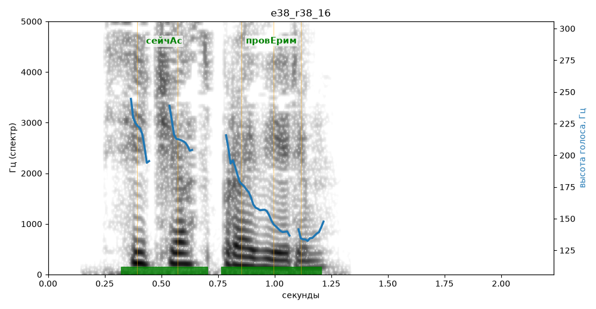

# e38_r38_16

Голос: **edge:ru-RU-SvetlanaNeural** · длительность 2.2 с
Естественность (UTMOS): **3.96 из 5** (живой диктор ≈ 4–4.5)
Эталон: Сейчас проверим!
Распознано: Сейчас проверим.
Слова: все совпали

## Ударения
(где нужно: ruaccent)

| слово | нужно | у голоса | |
|---|---|---|---|
| сейчас | сейчАс | сейчАс | ✓ |
| проверим | провЕрим | провЕрим | ✓ |

## Интонация
- ✓ «сейчас проверим!» — выделено слово «сейчас» (+3.0 пт)
- Диапазон голоса 9.2 полутонов (живо), средняя высота 171 Гц

## Паузы и темп
- паузы на своих местах
- Темп 5.7 слога/с (нормально)

_Синяя линия — высота голоса. Над словами заглавная буква — где ударение должно быть; красным — голос поставил не туда (уверенно), оранжевым — возможно._
