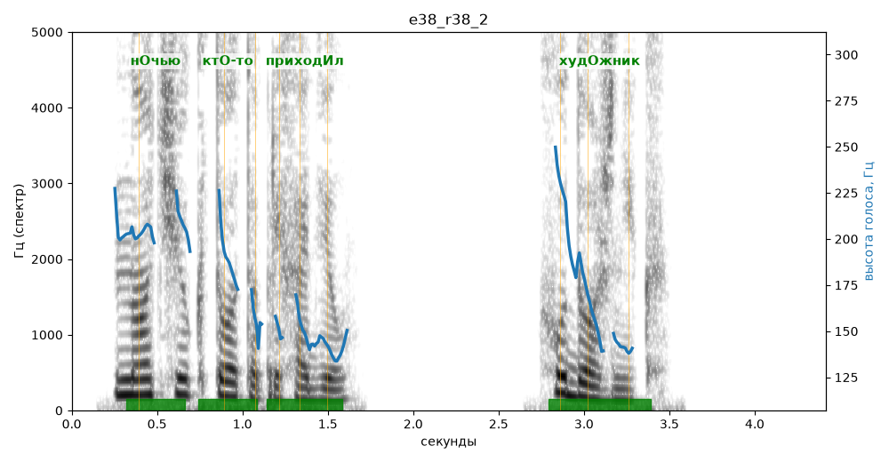

# e38_r38_2

Голос: **edge:ru-RU-SvetlanaNeural** · длительность 4.4 с
Естественность (UTMOS): **3.93 из 5** (живой диктор ≈ 4–4.5)
Эталон: Ночью кто-то приходил! Художник!
Распознано: Ночью кто-то приходил. Художник.
Слова: все совпали

## Ударения
(где нужно: ruaccent)

| слово | нужно | у голоса | |
|---|---|---|---|
| ночью | нОчью | нОчью | ✓ |
| кто-то | ктО-то | ктО-то | ✓ |
| приходил | приходИл | приходИл | ✓ |
| художник | худОжник | худОжник | ✓ |

## Интонация
- ✓ «ночью кто-то приходил!» — выделено слово «ночью» (+4.9 пт)
- ✗ «художник!» — восклицание звучит ровно, без эмоции
- Диапазон голоса 8.5 полутонов (живо), средняя высота 173 Гц

## Паузы и темп
- паузы на своих местах
- Темп 4.8 слога/с (нормально)

_Синяя линия — высота голоса. Над словами заглавная буква — где ударение должно быть; красным — голос поставил не туда (уверенно), оранжевым — возможно._
