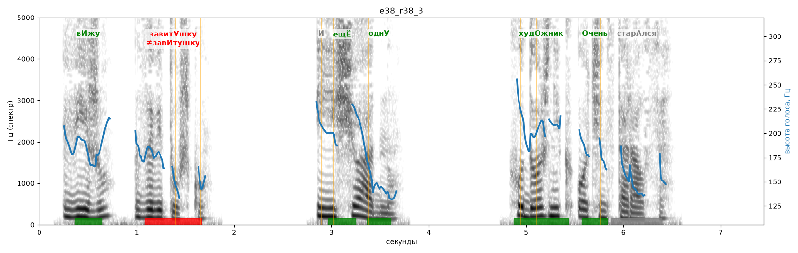

# e38_r38_3

Голос: **edge:ru-RU-SvetlanaNeural** · длительность 7.4 с
Естественность (UTMOS): **3.88 из 5** (живой диктор ≈ 4–4.5)
Эталон: Вижу… завитушку. И ещё одну. Художник очень старался.
Распознано: вижу завитушку и еще одну художник очень старался
Слова: все совпали

## Ударения
(где нужно: ruaccent)

| слово | нужно | у голоса | |
|---|---|---|---|
| вижу | вИжу | вИжу | ✓ |
| завитушку | завитУшку | завИтушку | ✗ ОШИБКА |
| ещё | ещЁ | ещЁ | ✓ |
| одну | однУ | однУ | ✓ |
| художник | худОжник | худОжник | ✓ |
| очень | Очень | Очень | ✓ |
| старался | старАлся | старалсЯ | ? не разобрать |

## Интонация
- ✓ «завитушку.» — конец фразы понижается — звучит законченно
- ✓ «и ещё одну.» — конец фразы понижается — звучит законченно
- ✓ «художник очень старался.» — конец фразы понижается — звучит законченно
- Диапазон голоса 8.1 полутонов (живо), средняя высота 182 Гц

## Паузы и темп
- паузы на своих местах
- Темп 6.1 слога/с (нормально)

_Синяя линия — высота голоса. Над словами заглавная буква — где ударение должно быть; красным — голос поставил не туда (уверенно), оранжевым — возможно._
