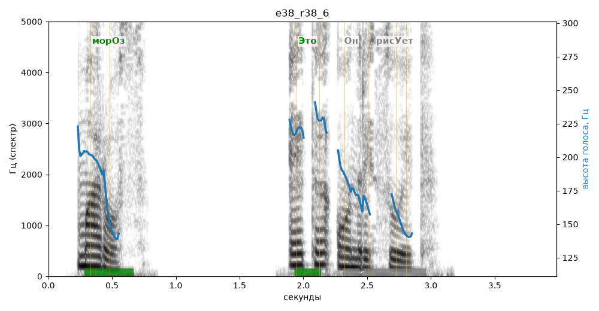

# e38_r38_6

Голос: **edge:ru-RU-SvetlanaNeural** · длительность 4.0 с
Естественность (UTMOS): **3.78 из 5** (живой диктор ≈ 4–4.5)
Эталон: Мороз! Это он рисует!
Распознано: Мороз. Это он рисует.
Слова: все совпали

## Ударения
(где нужно: ruaccent)

| слово | нужно | у голоса | |
|---|---|---|---|
| мороз | морОз | морОз | ✓ |
| это | Это | Это | ✓ |
| рисует | рисУет | рИсует | ? не разобрать |

## Интонация
- ✓ «это он рисует!» — выделено слово «это» (+4.0 пт)
- Диапазон голоса 8.3 полутонов (живо), средняя высота 186 Гц

## Паузы и темп
- паузы на своих местах
- Темп 6.5 слога/с (нормально)

_Синяя линия — высота голоса. Над словами заглавная буква — где ударение должно быть; красным — голос поставил не туда (уверенно), оранжевым — возможно._
