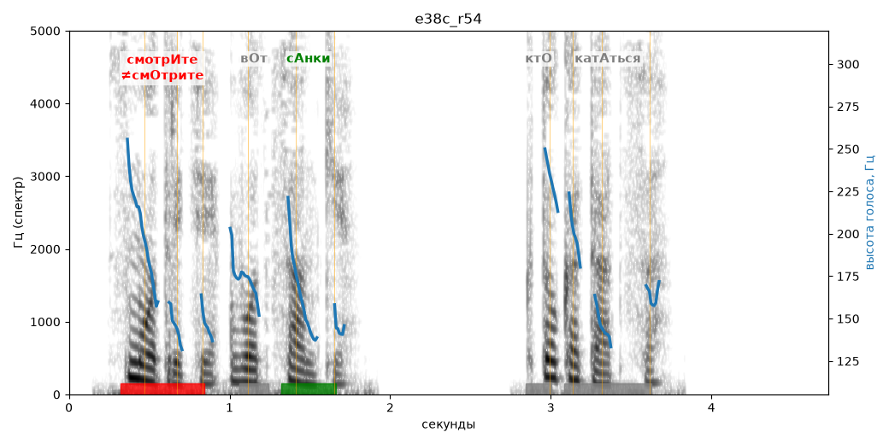

# e38c_r54

Голос: **edge:ru-RU-SvetlanaNeural** · длительность 4.7 с
Эталон: Смотрите, вот санки! Кто кататься?
Распознано: Смотрите, вот санки. Кто кататься?
Слова: все совпали

## Ударения
(где нужно: ruaccent)

| слово | нужно | у голоса | |
|---|---|---|---|
| смотрите | смотрИте | смОтрите | ✗ ОШИБКА |
| санки | сАнки | сАнки | ✓ |
| кататься | катАться | кАтаться | ? не разобрать |

## Интонация
- ✓ «смотрите вот санки!» — выделено слово «вот» (+2.1 пт)
- ✓ «кто кататься?» — конец фразы понижается — звучит законченно
- Диапазон голоса 8.9 полутонов (живо), средняя высота 167 Гц

## Паузы и темп
- паузы на своих местах
- Темп 5.3 слога/с (нормально)

_Синяя линия — высота голоса. Над словами заглавная буква — где ударение должно быть; красным — голос поставил не туда (уверенно), оранжевым — возможно._
