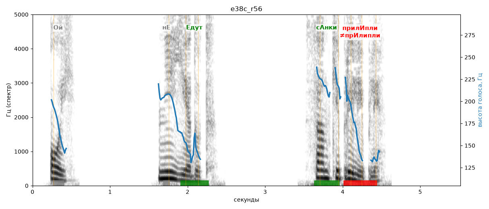

# e38c_r56

Голос: **edge:ru-RU-SvetlanaNeural** · длительность 5.5 с
Эталон: Ой. Не едут. Санки прилипли!
Распознано: Ой! Не едут! Санки прилипли!
Слова: все совпали

## Ударения
(где нужно: ruaccent)

| слово | нужно | у голоса | |
|---|---|---|---|
| едут | Едут | Едут | ✓ |
| санки | сАнки | сАнки | ✓ |
| прилипли | прилИпли | прИлипли | ✗ ОШИБКА |

## Интонация
- ✗ «не едут.» — конец фразы не понижается — звучит незаконченно / как перечисление
- ✓ «санки прилипли!» — выделено слово «санки» (+2.2 пт)
- Диапазон голоса 9.1 полутонов (живо), средняя высота 181 Гц

## Паузы и темп
- паузы на своих местах
- Темп 5.9 слога/с (нормально)

_Синяя линия — высота голоса. Над словами заглавная буква — где ударение должно быть; красным — голос поставил не туда (уверенно), оранжевым — возможно._
