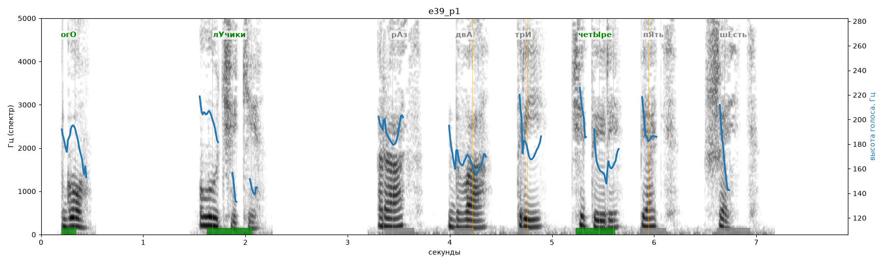

# e39_p1

Голос: **edge:ru-RU-SvetlanaNeural** · длительность 7.9 с
Естественность (UTMOS): **3.85 из 5** (живой диктор ≈ 4–4.5)
Эталон: Ого! Лучики! Раз, два, три, четыре, пять, шесть!
Распознано: ГО. Лучики. Раз, два, три, четыре, пять, шесть.
Расхождения в словах: «ого» → «го»

## Ударения
(где нужно: ruaccent)

| слово | нужно | у голоса | |
|---|---|---|---|
| ого | огО | огО | ✓ |
| лучики | лУчики | лУчики | ✓ |
| четыре | четЫре | четЫре | ✓ |

## Интонация
- ✓ «лучики!» — выделено слово «лучики» (+6.0 пт)
- ✗ «раз два три четыре пять шесть!» — восклицание звучит ровно, без эмоции
- Диапазон голоса 6.2 полутонов (нормально), средняя высота 178 Гц

## Паузы и темп
- паузы на своих местах
- Темп 6.2 слога/с (нормально)

_Синяя линия — высота голоса. Над словами заглавная буква — где ударение должно быть; красным — голос поставил не туда (уверенно), оранжевым — возможно._
