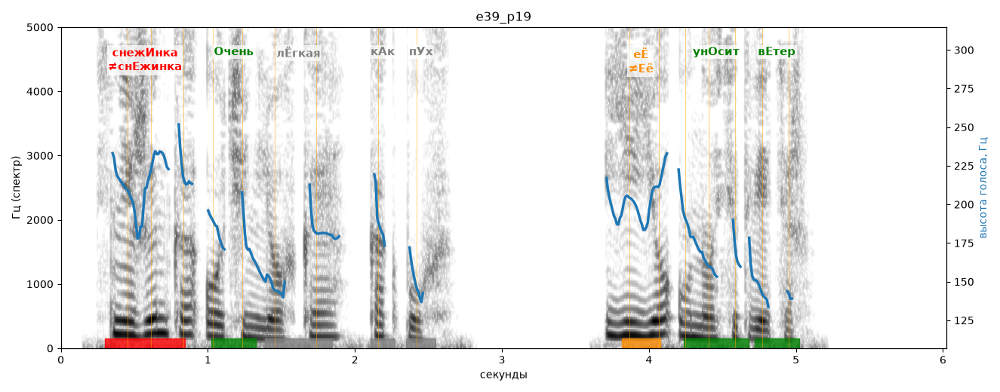

# e39_p19

Голос: **edge:ru-RU-SvetlanaNeural** · длительность 6.0 с
Естественность (UTMOS): **3.84 из 5** (живой диктор ≈ 4–4.5)
Эталон: Снежинка очень лёгкая, как пух. Её уносит ветер.
Распознано: Снежинка очень легкая, как пух. Ее уносит ветер.
Слова: все совпали

## Ударения
(где нужно: ruaccent)

| слово | нужно | у голоса | |
|---|---|---|---|
| снежинка | снежИнка | снЕжинка | ✗ ОШИБКА |
| очень | Очень | Очень | ✓ |
| лёгкая | лЁгкая | — | ? |
| её | еЁ | Её | ✗? возможно — послушать |
| уносит | унОсит | унОсит | ✓ |
| ветер | вЕтер | вЕтер | ✓ |

## Интонация
- ✓ «снежинка очень лёгкая как пух.» — конец фразы понижается — звучит законченно
- ✓ «её уносит ветер.» — конец фразы понижается — звучит законченно
- Диапазон голоса 8.4 полутонов (живо), средняя высота 185 Гц

## Паузы и темп
- паузы на своих местах
- Темп 5.6 слога/с (нормально)

_Синяя линия — высота голоса. Над словами заглавная буква — где ударение должно быть; красным — голос поставил не туда (уверенно), оранжевым — возможно._
