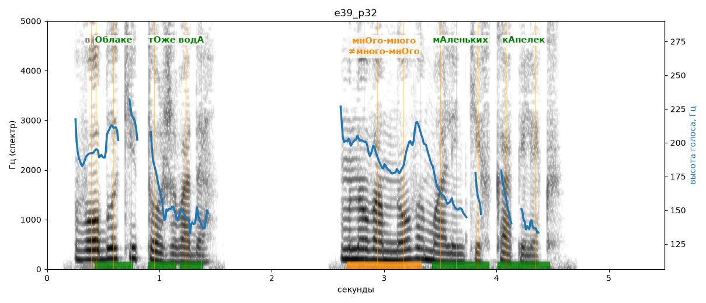

# e39_p32

Голос: **edge:ru-RU-SvetlanaNeural** · длительность 5.5 с
Естественность (UTMOS): **3.55 из 5** (живой диктор ≈ 4–4.5)
Эталон: В облаке тоже вода. Много-много маленьких капелек.
Распознано: В облаке тоже вода. Много-много маленьких капелек.
Слова: все совпали

## Ударения
(где нужно: ruaccent)

| слово | нужно | у голоса | |
|---|---|---|---|
| облаке | Облаке | Облаке | ✓ |
| тоже | тОже | тОже | ✓ |
| вода | водА | водА | ✓ |
| много-много | мнОго-много | много-мнОго | ✗? возможно — послушать |
| маленьких | мАленьких | мАленьких | ✓ |
| капелек | кАпелек | кАпелек | ✓ |

## Интонация
- ✓ «в облаке тоже вода.» — конец фразы понижается — звучит законченно
- ✓ «много-много маленьких капелек.» — конец фразы понижается — звучит законченно
- Диапазон голоса 7.5 полутонов (живо), средняя высота 180 Гц

## Паузы и темп
- паузы на своих местах
- Темп 6.3 слога/с (нормально)

_Синяя линия — высота голоса. Над словами заглавная буква — где ударение должно быть; красным — голос поставил не туда (уверенно), оранжевым — возможно._
