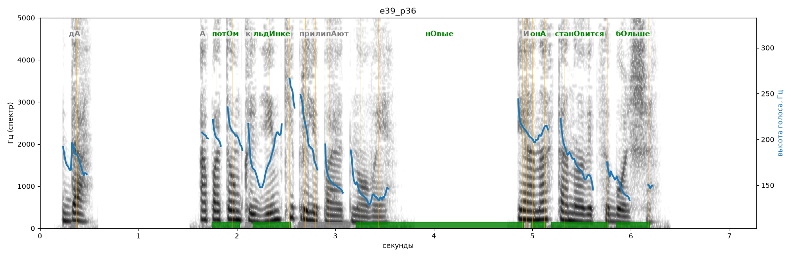

# e39_p36

Голос: **edge:ru-RU-SvetlanaNeural** · длительность 7.3 с
Естественность (UTMOS): **3.81 из 5** (живой диктор ≈ 4–4.5)
Эталон: Да. А потом к льдинке прилипают новые. И она становится больше.
Распознано: Да. А потом кальдинки прилипают новые. И она становится больше.
Расхождения в словах: «к льдинке» → «кальдинки»

## Ударения
(где нужно: ruaccent)

| слово | нужно | у голоса | |
|---|---|---|---|
| потом | потОм | потОм | ✓ |
| льдинке | льдИнке | льдИнке | ✓ |
| прилипают | прилипАют | — | ? |
| новые | нОвые | нОвые | ✓ |
| она | онА | онА | ✓ |
| становится | станОвится | станОвится | ✓ |
| больше | бОльше | бОльше | ✓ |

## Интонация
- ✓ «а потом к льдинке прилипают новые.» — конец фразы понижается — звучит законченно
- ✓ «и она становится больше.» — конец фразы понижается — звучит законченно
- Диапазон голоса 8.5 полутонов (живо), средняя высота 174 Гц

## Паузы и темп
- после «новые.» пауза всего 0.02 с — фразы слипаются
- Темп 4.8 слога/с (нормально)

_Синяя линия — высота голоса. Над словами заглавная буква — где ударение должно быть; красным — голос поставил не туда (уверенно), оранжевым — возможно._
