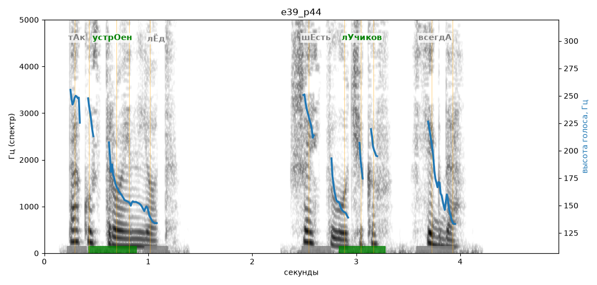

# e39_p44

Голос: **edge:ru-RU-SvetlanaNeural** · длительность 4.9 с
Естественность (UTMOS): **3.88 из 5** (живой диктор ≈ 4–4.5)
Эталон: Так устроен лёд. Шесть лучиков — всегда!
Распознано: Так устроен лед. Шесть целучиков всегда.
Расхождения в словах: «лучиков» → «целучиков»

## Ударения
(где нужно: ruaccent)

| слово | нужно | у голоса | |
|---|---|---|---|
| устроен | устрОен | устрОен | ✓ |
| лучиков | лУчиков | лУчиков | ✓ |
| всегда | всегдА | всЕгда | ? не разобрать |

## Интонация
- ✓ «так устроен лёд.» — конец фразы понижается — звучит законченно
- ✓ «шесть лучиков всегда!» — выделено слово «шесть» (+4.1 пт)
- Диапазон голоса 10.6 полутонов (живо), средняя высота 162 Гц

## Паузы и темп
- паузы на своих местах
- Темп 5.2 слога/с (нормально)

_Синяя линия — высота голоса. Над словами заглавная буква — где ударение должно быть; красным — голос поставил не туда (уверенно), оранжевым — возможно._
