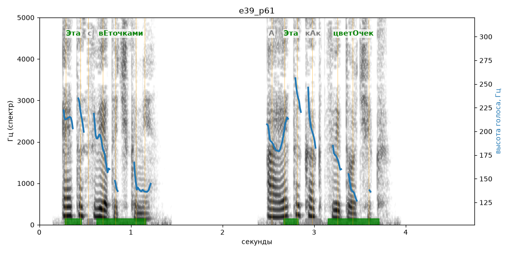

# e39_p61

Голос: **edge:ru-RU-SvetlanaNeural** · длительность 4.8 с
Естественность (UTMOS): **3.84 из 5** (живой диктор ≈ 4–4.5)
Эталон: Эта с веточками. А эта как цветочек.
Распознано: Это светочками. А это как цветочек.
Расхождения в словах: «эта с веточками» → «это светочками»; «эта» → «это»

## Ударения
(где нужно: ruaccent)

| слово | нужно | у голоса | |
|---|---|---|---|
| эта | Эта | Эта | ✓ |
| веточками | вЕточками | вЕточками | ✓ |
| эта | Эта | Эта | ✓ |
| цветочек | цветОчек | цветОчек | ✓ |

## Интонация
- ✗ «эта с веточками.» — конец фразы не понижается — звучит незаконченно / как перечисление
- ✓ «а эта как цветочек.» — конец фразы понижается — звучит законченно
- Диапазон голоса 9.2 полутонов (живо), средняя высота 183 Гц

## Паузы и темп
- паузы на своих местах
- Темп 6.8 слога/с (быстро)

_Синяя линия — высота голоса. Над словами заглавная буква — где ударение должно быть; красным — голос поставил не туда (уверенно), оранжевым — возможно._
