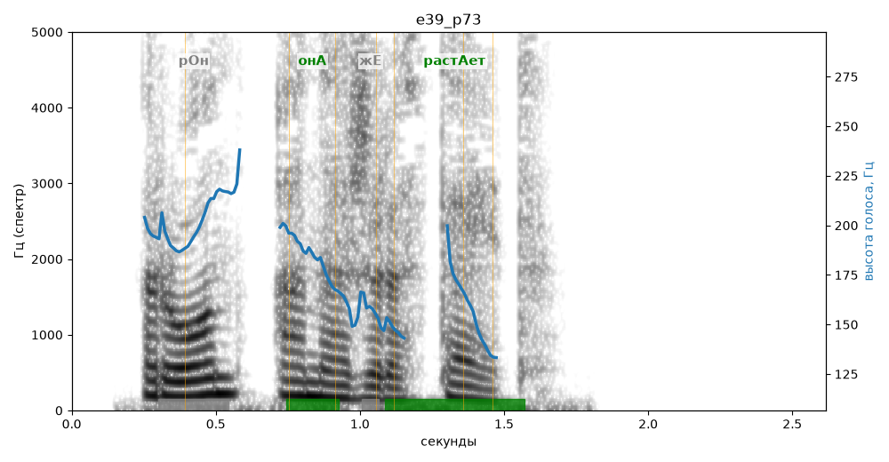

# e39_p73

Голос: **edge:ru-RU-SvetlanaNeural** · длительность 2.6 с
Естественность (UTMOS): **3.91 из 5** (живой диктор ≈ 4–4.5)
Эталон: Рон, она же растает…
Распознано: Рон, она же растает.
Слова: все совпали

## Ударения
(где нужно: ruaccent)

| слово | нужно | у голоса | |
|---|---|---|---|
| она | онА | онА | ✓ |
| растает | растАет | растАет | ✓ |

## Интонация
- ✗ «рон она же растает…» — конец фразы не понижается — звучит незаконченно / как перечисление
- Диапазон голоса 7.4 полутонов (живо), средняя высота 184 Гц

## Паузы и темп
- паузы на своих местах
- Темп 6.6 слога/с (быстро)

_Синяя линия — высота голоса. Над словами заглавная буква — где ударение должно быть; красным — голос поставил не туда (уверенно), оранжевым — возможно._
