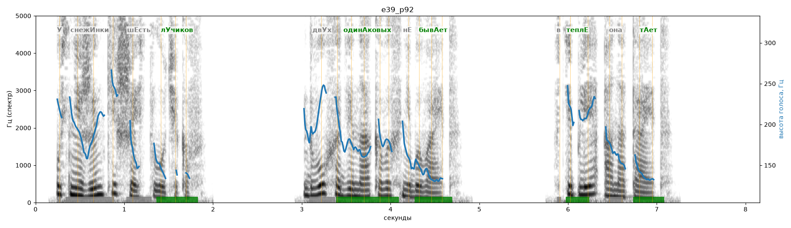

# e39_p92

Голос: **edge:ru-RU-SvetlanaNeural** · длительность 8.2 с
Естественность (UTMOS): **3.69 из 5** (живой диктор ≈ 4–4.5)
Эталон: У снежинки шесть лучиков. Двух одинаковых не бывает. В тепле она тает.
Распознано: У снежинки 6 лучиков. Двух одинаковых не бывает. В тепле она тает.
Расхождения в словах: «шесть» → «6»

## Ударения
(где нужно: ruaccent)

| слово | нужно | у голоса | |
|---|---|---|---|
| снежинки | снежИнки | снЕжинки | ? не разобрать |
| лучиков | лУчиков | лУчиков | ✓ |
| одинаковых | одинАковых | одинАковых | ✓ |
| бывает | бывАет | бывАет | ✓ |
| тепле | теплЕ | теплЕ | ✓ |
| она | она | онА | нет эталона |
| тает | тАет | тАет | ✓ |

## Интонация
- ✓ «у снежинки шесть лучиков.» — конец фразы понижается — звучит законченно
- ✓ «двух одинаковых не бывает.» — конец фразы понижается — звучит законченно
- ✓ «в тепле она тает.» — конец фразы понижается — звучит законченно
- Диапазон голоса 9.8 полутонов (живо), средняя высота 173 Гц

## Паузы и темп
- паузы на своих местах
- Темп 6.0 слога/с (нормально)

_Синяя линия — высота голоса. Над словами заглавная буква — где ударение должно быть; красным — голос поставил не туда (уверенно), оранжевым — возможно._
