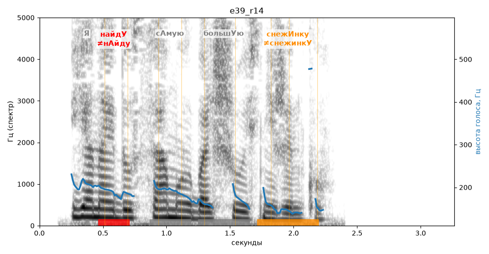

# e39_r14

Голос: **edge:ru-RU-SvetlanaNeural** · длительность 3.3 с
Естественность (UTMOS): **3.95 из 5** (живой диктор ≈ 4–4.5)
Эталон: Я найду самую большую снежинку!
Распознано: Я найду самую большую снежинку.
Слова: все совпали

## Ударения
(где нужно: ruaccent)

| слово | нужно | у голоса | |
|---|---|---|---|
| найду | найдУ | нАйду | ✗ ОШИБКА |
| самую | сАмую | — | ? |
| большую | большУю | — | ? |
| снежинку | снежИнку | снежинкУ | ✗? возможно — послушать |

## Интонация
- ✓ «я найду самую большую снежинку!» — выделено слово «самую» (+2.6 пт)
- Диапазон голоса 7.3 полутонов (живо), средняя высота 180 Гц

## Паузы и темп
- паузы на своих местах
- Темп 5.4 слога/с (нормально)

_Синяя линия — высота голоса. Над словами заглавная буква — где ударение должно быть; красным — голос поставил не туда (уверенно), оранжевым — возможно._
