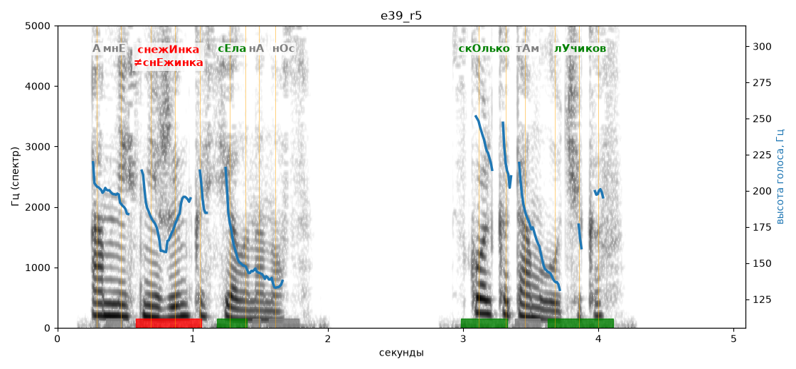

# e39_r5

Голос: **edge:ru-RU-SvetlanaNeural** · длительность 5.1 с
Естественность (UTMOS): **4.02 из 5** (живой диктор ≈ 4–4.5)
Эталон: А мне снежинка села на нос! Сколько там лучиков?
Распознано: А мне снежинка села на нос. Сколько там лучиков?
Слова: все совпали

## Ударения
(где нужно: ruaccent)

| слово | нужно | у голоса | |
|---|---|---|---|
| снежинка | снежИнка | снЕжинка | ✗ ОШИБКА |
| села | сЕла | сЕла | ✓ |
| сколько | скОлько | скОлько | ✓ |
| лучиков | лУчиков | лУчиков | ✓ |

## Интонация
- ✓ «а мне снежинка села на нос!» — выделено слово «а» (+2.3 пт)
- ✓ «сколько там лучиков?» — конец фразы понижается — звучит законченно
- Диапазон голоса 9.1 полутонов (живо), средняя высота 181 Гц

## Паузы и темп
- паузы на своих местах
- Темп 5.7 слога/с (нормально)

_Синяя линия — высота голоса. Над словами заглавная буква — где ударение должно быть; красным — голос поставил не туда (уверенно), оранжевым — возможно._
