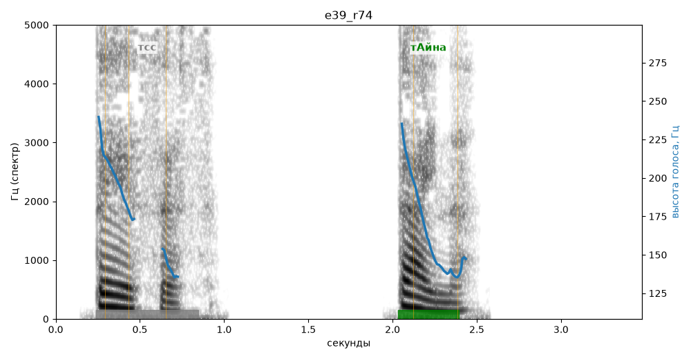

# e39_r74

Голос: **edge:ru-RU-SvetlanaNeural** · длительность 3.5 с
Естественность (UTMOS): **4.02 из 5** (живой диктор ≈ 4–4.5)
Эталон: Тсс! Тайна.
Распознано: ТСС. Тайна.
Слова: все совпали

## Ударения
(где нужно: ruaccent)

| слово | нужно | у голоса | |
|---|---|---|---|
| тайна | тАйна | тАйна | ✓ |

## Интонация
- Диапазон голоса 8.5 полутонов (живо), средняя высота 171 Гц

## Паузы и темп
- паузы на своих местах
- Темп 5.2 слога/с (нормально)

_Синяя линия — высота голоса. Над словами заглавная буква — где ударение должно быть; красным — голос поставил не туда (уверенно), оранжевым — возможно._
