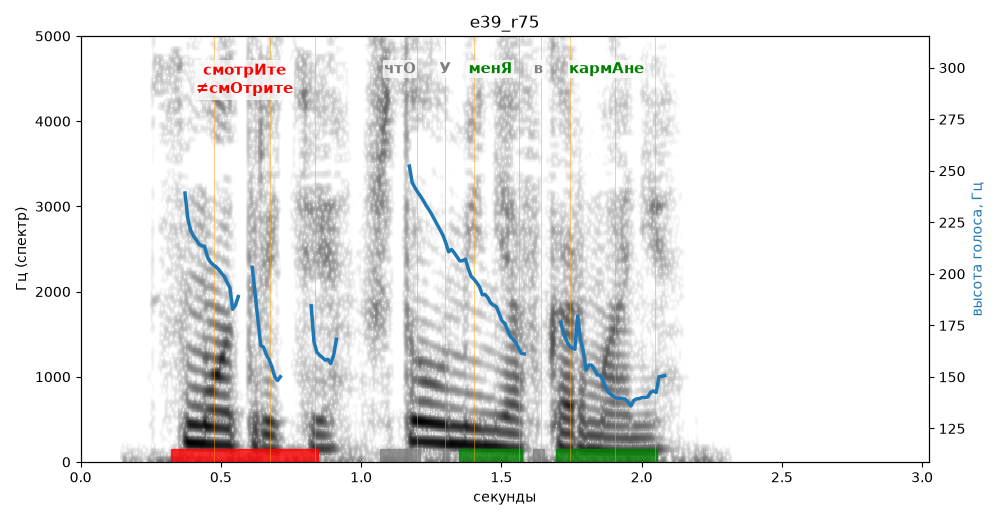

# e39_r75

Голос: **edge:ru-RU-SvetlanaNeural** · длительность 3.0 с
Естественность (UTMOS): **3.95 из 5** (живой диктор ≈ 4–4.5)
Эталон: Смотрите, что у меня в кармане!
Распознано: Смотрите, что у меня в кармане.
Слова: все совпали

## Ударения
(где нужно: ruaccent)

| слово | нужно | у голоса | |
|---|---|---|---|
| смотрите | смотрИте | смОтрите | ✗ ОШИБКА |
| меня | менЯ | менЯ | ✓ |
| кармане | кармАне | кармАне | ✓ |

## Интонация
- ✓ «смотрите что у меня в кармане!» — выделено слово «что» (+6.2 пт)
- Диапазон голоса 9.1 полутонов (живо), средняя высота 176 Гц

## Паузы и темп
- паузы на своих местах
- Темп 7.3 слога/с (быстро)

_Синяя линия — высота голоса. Над словами заглавная буква — где ударение должно быть; красным — голос поставил не туда (уверенно), оранжевым — возможно._
