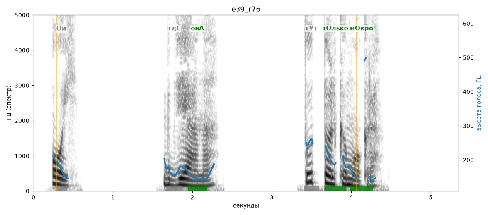

# e39_r76

Голос: **edge:ru-RU-SvetlanaNeural** · длительность 5.4 с
Естественность (UTMOS): **3.52 из 5** (живой диктор ≈ 4–4.5)
Эталон: Ой! Где она? Тут только мокро!
Распознано: Ой! Где она? Тут только мокра.
Расхождения в словах: «мокро» → «мокра»

## Ударения
(где нужно: ruaccent)

| слово | нужно | у голоса | |
|---|---|---|---|
| она | онА | онА | ✓ |
| только | тОлько | тОлько | ✓ |
| мокро | мОкро | мОкро | ✓ |

## Интонация
- ✓ «где она?» — конец фразы понижается — звучит законченно
- ✓ «тут только мокро!» — выделено слово «тут» (+5.8 пт)
- Диапазон голоса 9.7 полутонов (живо), средняя высота 170 Гц

## Паузы и темп
- паузы на своих местах
- Темп 6.0 слога/с (нормально)

_Синяя линия — высота голоса. Над словами заглавная буква — где ударение должно быть; красным — голос поставил не туда (уверенно), оранжевым — возможно._
