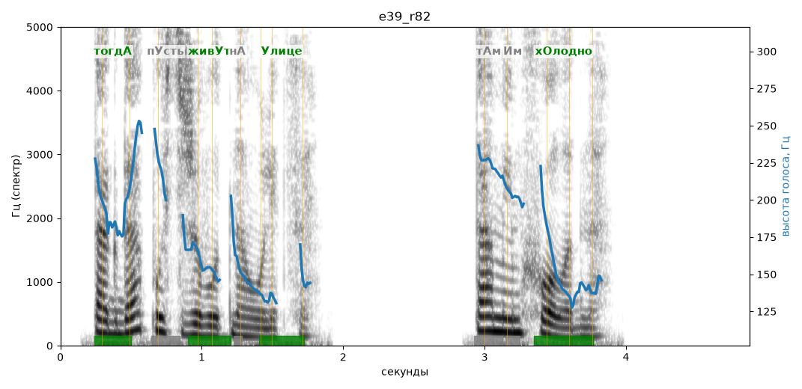

# e39_r82

Голос: **edge:ru-RU-SvetlanaNeural** · длительность 4.9 с
Естественность (UTMOS): **3.82 из 5** (живой диктор ≈ 4–4.5)
Эталон: Тогда пусть живут на улице. Там им холодно.
Распознано: Тогда пусть живут на улице. Там им холодно.
Слова: все совпали

## Ударения
(где нужно: ruaccent)

| слово | нужно | у голоса | |
|---|---|---|---|
| тогда | тогдА | тогдА | ✓ |
| живут | живУт | живУт | ✓ |
| улице | Улице | Улице | ✓ |
| холодно | хОлодно | хОлодно | ✓ |

## Интонация
- ✓ «тогда пусть живут на улице.» — конец фразы понижается — звучит законченно
- ✗ «там им холодно.» — конец фразы не понижается — звучит незаконченно / как перечисление
- Диапазон голоса 9.4 полутонов (живо), средняя высота 167 Гц

## Паузы и темп
- паузы на своих местах
- Темп 6.0 слога/с (нормально)

_Синяя линия — высота голоса. Над словами заглавная буква — где ударение должно быть; красным — голос поставил не туда (уверенно), оранжевым — возможно._
