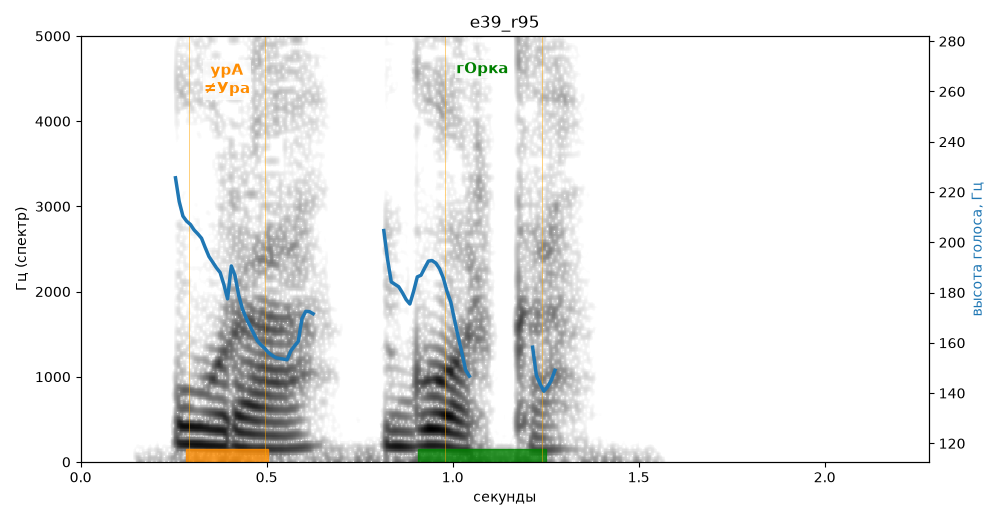

# e39_r95

Голос: **edge:ru-RU-SvetlanaNeural** · длительность 2.3 с
Естественность (UTMOS): **3.84 из 5** (живой диктор ≈ 4–4.5)
Эталон: Ура, горка!
Распознано: Ура, горка.
Слова: все совпали

## Ударения
(где нужно: ruaccent)

| слово | нужно | у голоса | |
|---|---|---|---|
| ура | урА | Ура | ✗? возможно — послушать |
| горка | гОрка | гОрка | ✓ |

## Интонация
- ✗ «ура горка!» — восклицание звучит ровно, без эмоции
- Диапазон голоса 6.2 полутонов (нормально), средняя высота 177 Гц

## Паузы и темп
- паузы на своих местах
- Темп 7.1 слога/с (быстро)

_Синяя линия — высота голоса. Над словами заглавная буква — где ударение должно быть; красным — голос поставил не туда (уверенно), оранжевым — возможно._
