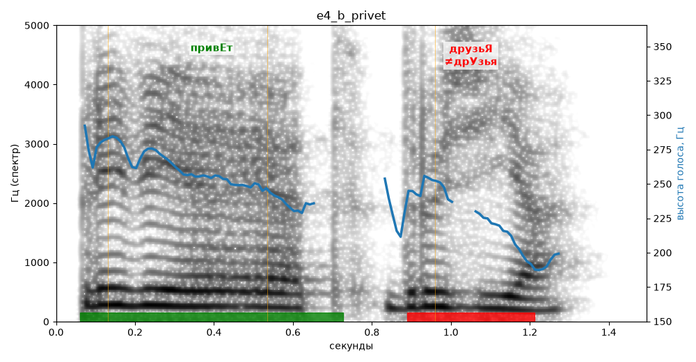

# e4_b_privet

Естественность (UTMOS): **1.73 из 5** (живой диктор ≈ 4–4.5)
Эталон: Привет, друзья!
Распознано: Привет, друзья!
Слова: все совпали

## Ударения
(где нужно: ruaccent)

| слово | нужно | у голоса | |
|---|---|---|---|
| привет | привЕт | привЕт | ✓ |
| друзья | друзьЯ | дрУзья | ✗ ОШИБКА |

## Интонация
- ✗ «привет друзья!» — восклицание звучит ровно, без эмоции
- Диапазон голоса 6.5 полутонов (нормально), средняя высота 248 Гц

## Паузы и темп
- паузы на своих местах
- Темп 3.0 слога/с (медленно)

_Синяя линия — высота голоса. Над словами заглавная буква — где ударение должно быть; красным — голос поставил не туда (уверенно), оранжевым — возможно._
