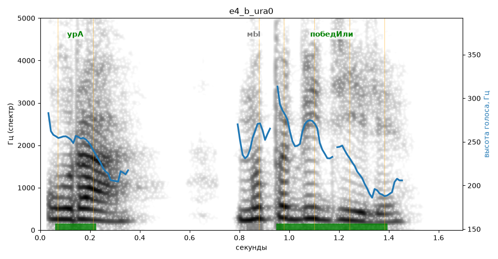

# e4_b_ura0

Естественность (UTMOS): **3.44 из 5** (живой диктор ≈ 4–4.5)
Эталон: Ура! Мы победили!
Распознано: Ура! Мы победили!
Слова: все совпали

## Ударения
(где нужно: ruaccent)

| слово | нужно | у голоса | |
|---|---|---|---|
| ура | урА | урА | ✓ |
| победили | победИли | победИли | ✓ |

## Интонация
- ✗ «мы победили!» — восклицание звучит ровно, без эмоции
- Диапазон голоса 6.5 полутонов (нормально), средняя высота 244 Гц

## Паузы и темп
- паузы на своих местах
- Темп 9.6 слога/с (быстро)

_Синяя линия — высота голоса. Над словами заглавная буква — где ударение должно быть; красным — голос поставил не туда (уверенно), оранжевым — возможно._
