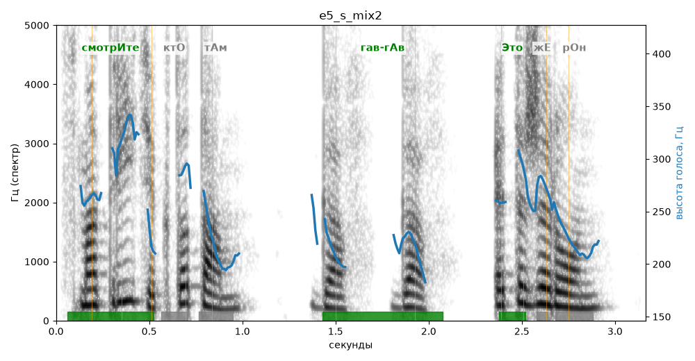

# e5_s_mix2

Естественность (UTMOS): **3.58 из 5** (живой диктор ≈ 4–4.5)
Эталон: Смотрите, кто там! Гав-гав! Это же Рон!
Распознано: Смотрите, кто там. Гав, Гав, это Жерон.
Расхождения в словах: «гав-гав» → «гав гав»; «же рон» → «жерон»

## Ударения
(где нужно: ruaccent)

| слово | нужно | у голоса | |
|---|---|---|---|
| смотрите | смотрИте | смотрИте | ✓ |
| гав-гав | гав-гАв | гав-гАв | ✓ |
| это | Это | Это | ✓ |

## Интонация
- ✓ «смотрите кто там!» — выделено слово «смотрите» (+3.5 пт)
- ✗ «это же рон!» — восклицание звучит ровно, без эмоции
- Диапазон голоса 8.5 полутонов (живо), средняя высота 237 Гц

## Паузы и темп
- после «смотрите,» нет паузы (0.04 с)
- Темп 5.4 слога/с (нормально)

_Синяя линия — высота голоса. Над словами заглавная буква — где ударение должно быть; красным — голос поставил не туда (уверенно), оранжевым — возможно._
