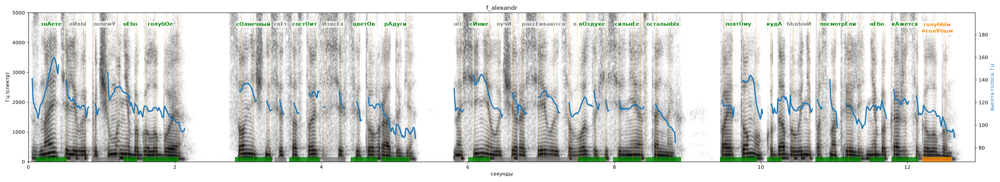

# f_alexandr

Голос: **silero_cis:ru_alexandr** · длительность 12.9 с
Естественность (UTMOS): **3.17 из 5** (живой диктор ≈ 4–4.5)
Эталон: Зн+аете ли вы, почем+у н+ебо голуб+ое? С+олнечный свет сост+оит из всех цвет+ов р+адуги. Но с+иние луч+и расс+еиваются в в+оздухе сильн+ее остальн+ых. Поэт+ому, куд+а бы вы ни посмотр+ели, н+ебо к+ажется голуб+ым.
Распознано: Знаете ли вы почему небо голубое? Солнечный свет состоится из всех цветов радуги. На синей луче рассеиваются в воздухе сильнее остальных. Поэтому, куда бы вы ни посмотрели, небо кажется голубым.
Расхождения в словах: «состоит» → «состоится»; «но синие лучи» → «на синей луче»

## Ударения
(где нужно: дано в тексте)

| слово | нужно | у голоса | |
|---|---|---|---|
| знаете | знАете | знАете | ✓ |
| почему | почемУ | пОчему | ? не разобрать |
| небо | нЕбо | нЕбо | ✓ |
| голубое | голубОе | голубОе | ✓ |
| солнечный | сОлнечный | сОлнечный | ✓ |
| состоит | состОит | состОит | ✓ |
| цветов | цветОв | цветОв | ✓ |
| радуги | рАдуги | рАдуги | ✓ |
| синие | сИние | сИние | ✓ |
| лучи | лучИ | лУчи | ? не разобрать |
| рассеиваются | рассЕиваются | — | ? |
| воздухе | вОздухе | вОздухе | ✓ |
| сильнее | сильнЕе | сильнЕе | ✓ |
| остальных | остальнЫх | остальнЫх | ✓ |
| поэтому | поэтОму | поэтОму | ✓ |
| куда | кудА | кудА | ✓ |
| посмотрели | посмотрЕли | посмотрЕли | ✓ |
| небо | нЕбо | нЕбо | ✓ |
| кажется | кАжется | кАжется | ✓ |
| голубым | голубЫм | голУбым | ✗? возможно — послушать |

## Интонация
- ✗ «знаете ли вы почему небо голубое?» — нет вопросительного подъёма (самое высокое место — «почему», в начале) — звучит как утверждение
- ✓ «солнечный свет состоит из всех цветов радуги.» — конец фразы понижается — звучит законченно
- ✓ «но синие лучи рассеиваются в воздухе сильнее остальных.» — конец фразы понижается — звучит законченно
- ✓ «поэтому куда бы вы ни посмотрели небо кажется голубым.» — конец фразы понижается — звучит законченно
- Диапазон голоса 6.4 полутонов (нормально), средняя высота 116 Гц

## Паузы и темп
- паузы на своих местах
- Темп 6.6 слога/с (быстро)

_Синяя линия — высота голоса. Над словами заглавная буква — где ударение должно быть; красным — голос поставил не туда (уверенно), оранжевым — возможно._
