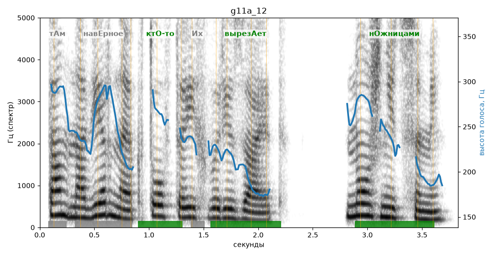

# g11a_12

Естественность (UTMOS): **3.19 из 5** (живой диктор ≈ 4–4.5)
Эталон: Там, наверное, кто-то их вырезает. Ножницами.
Распознано: Там, наверное, кто-то их вырезает. Ножницами.
Слова: все совпали

## Ударения
(где нужно: ruaccent)

| слово | нужно | у голоса | |
|---|---|---|---|
| наверное | навЕрное | нАверное | ? не разобрать |
| кто-то | ктО-то | ктО-то | ✓ |
| вырезает | вырезАет | вырезАет | ✓ |
| ножницами | нОжницами | нОжницами | ✓ |

## Интонация
- ✓ «там наверное кто-то их вырезает.» — конец фразы понижается — звучит законченно
- ✗ «ножницами.» — конец фразы не понижается — звучит незаконченно / как перечисление
- Диапазон голоса 8.7 полутонов (живо), средняя высота 234 Гц

## Паузы и темп
- паузы на своих местах
- Темп 5.6 слога/с (нормально)

_Синяя линия — высота голоса. Над словами заглавная буква — где ударение должно быть; красным — голос поставил не туда (уверенно), оранжевым — возможно._
