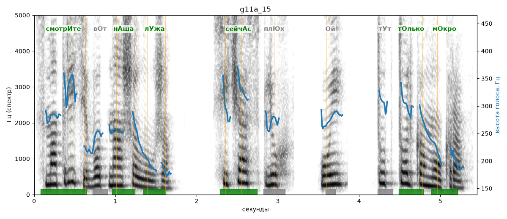

# g11a_15

Естественность (UTMOS): **2.93 из 5** (живой диктор ≈ 4–4.5)
Эталон: Смотрите, вот наша лужа. Сейчас — плюх! Ой! Тут только мокро!
Распознано: Смотрите вот наше лужа. Сейчас сплюх. Ой, тут только мокро.
Расхождения в словах: «наша» → «наше»; «плюх» → «сплюх»

## Ударения
(где нужно: ruaccent)

| слово | нужно | у голоса | |
|---|---|---|---|
| смотрите | смотрИте | смотрИте | ✓ |
| наша | нАша | нАша | ✓ |
| лужа | лУжа | лУжа | ✓ |
| сейчас | сейчАс | сейчАс | ✓ |
| только | тОлько | тОлько | ✓ |
| мокро | мОкро | мОкро | ✓ |

## Интонация
- ✓ «смотрите вот наша лужа.» — конец фразы понижается — звучит законченно
- ✓ «сейчас плюх!» — выделено слово «сейчас» (+2.0 пт)
- ✓ «тут только мокро!» — выделено слово «тут» (+2.5 пт)
- Диапазон голоса 10.6 полутонов (живо), средняя высота 266 Гц

## Паузы и темп
- паузы на своих местах
- Темп 4.9 слога/с (нормально)

_Синяя линия — высота голоса. Над словами заглавная буква — где ударение должно быть; красным — голос поставил не туда (уверенно), оранжевым — возможно._
