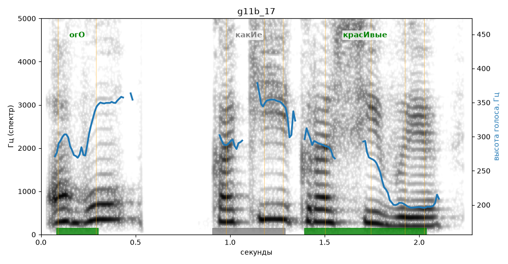

# g11b_17

Естественность (UTMOS): **3.11 из 5** (живой диктор ≈ 4–4.5)
Эталон: Ого! Какие красивые!
Распознано: А вот какие красивые!
Расхождения в словах: «ого» → «а вот»

## Ударения
(где нужно: ruaccent)

| слово | нужно | у голоса | |
|---|---|---|---|
| ого | огО | огО | ✓ |
| какие | какИе | кАкие | ? не разобрать |
| красивые | красИвые | красИвые | ✓ |

## Интонация
- ✓ «какие красивые!» — выделено слово «какие» (+3.5 пт)
- Диапазон голоса 10.2 полутонов (живо), средняя высота 289 Гц

## Паузы и темп
- паузы на своих местах
- Темп 6.7 слога/с (быстро)

_Синяя линия — высота голоса. Над словами заглавная буква — где ударение должно быть; красным — голос поставил не туда (уверенно), оранжевым — возможно._
