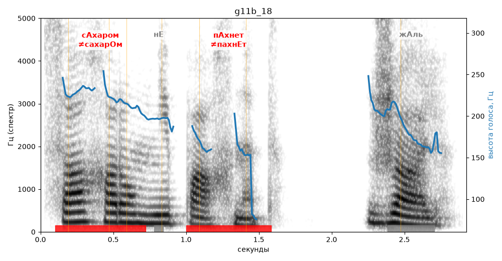

# g11b_18

Естественность (UTMOS): **3.21 из 5** (живой диктор ≈ 4–4.5)
Эталон: Са́харом не пахнет. Жаль.
Распознано: Сахаром не пахнет. Жаль.
Расхождения в словах: «са харом» → «сахаром»

## Ударения
(где нужно: ruaccent)

| слово | нужно | у голоса | |
|---|---|---|---|
| сахаром | сАхаром | сахарОм | ✗ ОШИБКА |
| пахнет | пАхнет | пахнЕт | ✗ ОШИБКА |

## Интонация
- ✓ «сахаром не пахнет.» — конец фразы понижается — звучит законченно
- Диапазон голоса 7.3 полутонов (живо), средняя высота 198 Гц

## Паузы и темп
- паузы на своих местах
- Темп 4.3 слога/с (нормально)

_Синяя линия — высота голоса. Над словами заглавная буква — где ударение должно быть; красным — голос поставил не туда (уверенно), оранжевым — возможно._
