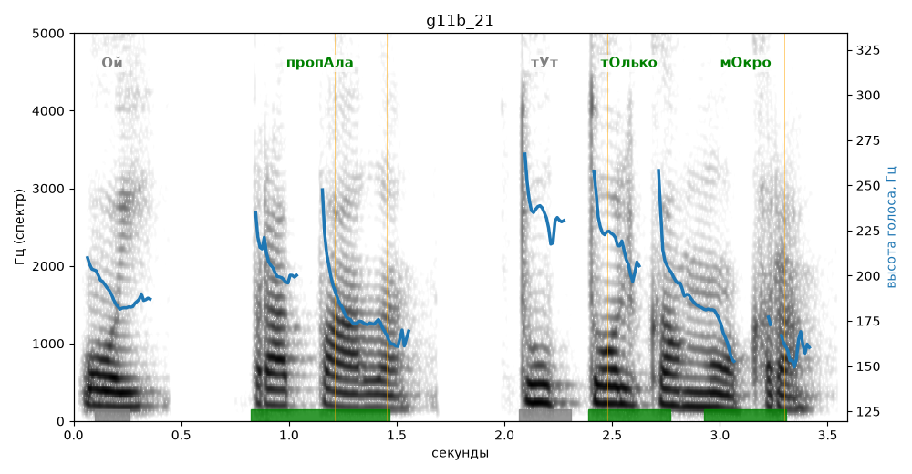

# g11b_21

Естественность (UTMOS): **2.49 из 5** (живой диктор ≈ 4–4.5)
Эталон: Ой! Пропала! Тут только мокро!
Распознано: Ой, пропала. Тут только мокра.
Расхождения в словах: «мокро» → «мокра»

## Ударения
(где нужно: ruaccent)

| слово | нужно | у голоса | |
|---|---|---|---|
| пропала | пропАла | пропАла | ✓ |
| только | тОлько | тОлько | ✓ |
| мокро | мОкро | мОкро | ✓ |

## Интонация
- ✗ «пропала!» — восклицание звучит ровно, без эмоции
- ✓ «тут только мокро!» — выделено слово «тут» (+3.0 пт)
- Диапазон голоса 6.8 полутонов (нормально), средняя высота 190 Гц

## Паузы и темп
- паузы на своих местах
- Темп 4.8 слога/с (нормально)

_Синяя линия — высота голоса. Над словами заглавная буква — где ударение должно быть; красным — голос поставил не туда (уверенно), оранжевым — возможно._
